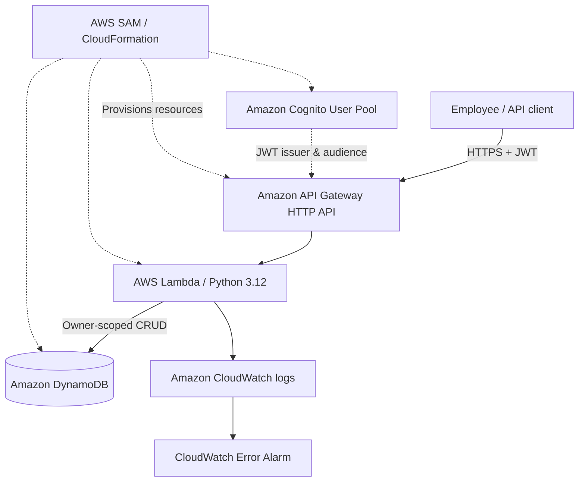

# CloudOps Service Desk | AWS Serverless IT Request Infrastructure

> **Project status: Deployed to AWS us-east-2 and initial end-to-end ticket creation and PATCH status update verified (2026-11-22).** This is a portfolio lab using a fictional business case, not a production customer implementation. Remaining security, monitoring and lifecycle tests are in progress.

## The business problem
A fictional 150-person business operating across three offices receives network, equipment, and software support issues by email and phone. Requests are difficult to track consistently, and the business does not want to manage dedicated application servers. The objective is to establish an authenticated, repeatable API foundation for recording and updating IT service requests.

## Proposed solution
An invitation-only employee identity in Amazon Cognito obtains a JSON Web Token. API Gateway verifies the token and forwards authorized requests to a Python Lambda function. The function creates, retrieves, or updates records in DynamoDB. A DynamoDB partition key derived from the user's Cognito `sub` limits access to that user's records. CloudWatch captures Lambda logs and maintains an error alarm. AWS SAM provisions everything as infrastructure as code.

This **MVP is user-scoped**: employees can track their own requests. An IT-wide technician queue, assignment, SLAs and RBAC are future enhancements, not implemented capabilities.

## Architecture



## AWS services and why
| Service | Why chosen |
|---|---|
| API Gateway HTTP API | Managed HTTPS entry point and Cognito JWT verification; sufficient for these CRUD routes. |
| AWS Lambda | On-demand Python compute without maintaining EC2 servers. |
| DynamoDB | Managed, on-demand data storage; owner-scoped access keys. |
| Cognito | Managed invitation-only employee identities and token issuance. |
| IAM | Limit Lambda DynamoDB permissions to the project table. |
| CloudWatch | Retained logs and a basic function error alarm. |
| AWS SAM + CloudFormation | Versioned, reproducible infrastructure creation and teardown. |

See [architecture decisions](docs/architecture.md) for security boundaries, decisions, and tradeoffs.

## What is implemented in the source
- `POST /requests` creates requests with title, description, category, priority.
- `GET /requests` returns the signed-in user's first page (up to 50) of requests.
- `GET /requests/{requestId}` returns one user-owned request.
- `PATCH /requests/{requestId}` updates only its status (`open`, `in_progress`, `resolved`).
- API Gateway JWT authorization backed by Cognito.
- DynamoDB ownerId/requestId key design; managed table encryption.
- Lambda logging, seven-day log retention, and an error alarm **without notification delivery**.
- Unit tests for input validation and a GitHub Actions test workflow.

**Verified so far (2026-11-22):** SAM stack deployed in `us-east-2`, test employee authenticated through Cognito, unauthorized request rejected, authenticated POST returned HTTP 201 and ticket appeared in DynamoDB, and authenticated PATCH returned HTTP 200 and status `in_progress` appeared in DynamoDB. Full test coverage, production security assessment, and cost measurements are not yet complete. See [test plan](docs/test-plan.md) and [evidence](evidence/README.md).

## Requirements
- An AWS account with permission to create CloudFormation/SAM, IAM roles, Lambda, API Gateway, DynamoDB, Cognito, CloudWatch and S3 deployment artifacts.
- AWS CLI v2, AWS SAM CLI, Python 3.12, Git.
- Configure AWS CLI with IAM Identity Center/SSO or other short-lived credentials; avoid using root or committing static keys.
- A billing budget/alert before deployment. Service usage and CloudWatch alarms may incur costs even during a lab.

## Deploy from your terminal

```bash
git clone https://github.com/YOUR-USERNAME/cloudops-service-desk.git
cd cloudops-service-desk
aws sts get-caller-identity
python -m pip install boto3
python -m unittest discover -s tests -v
sam validate
sam build
sam deploy --guided
```

On `sam deploy --guided`, choose a unique stack name such as `cloudops-service-desk`, your preferred AWS Region, allow SAM to create the necessary IAM roles, and keep the default confirmation prompts. **Do not disable security warnings without inspecting them.** Save the deployment settings locally (`samconfig.toml` is gitignored). Record the deployment outputs: `ApiUrl`, `UserPoolId`, `UserPoolClientId`, `RequestsTableName`.

### Create a lab user and obtain a JWT

Run these commands in a Bash-compatible shell (such as Git Bash). Replace the uppercase placeholders with *your own stack outputs* and use a **test-only email account** you control. Never paste passwords or JWTs into GitHub or screenshots.

```bash
export AWS_REGION=us-east-1 # change to the region you actually deployed
export USER_POOL_ID=YOUR_USER_POOL_ID
export CLIENT_ID=YOUR_USER_POOL_CLIENT_ID
export API_URL=https://YOUR_API_ID.execute-api.YOUR_REGION.amazonaws.com/prod
export TEST_EMAIL=you@example.com

aws cognito-idp admin-create-user \
  --region "$AWS_REGION" \
  --user-pool-id "$USER_POOL_ID" \
  --username "$TEST_EMAIL" \
  --user-attributes Name=email,Value="$TEST_EMAIL" \
  --message-action SUPPRESS

# Optional lab shortcut: set a permanent password using a secure local input.
# Avoid hardcoding passwords in shell history or repo files.
read -s -p 'New lab password: ' LAB_PASSWORD; echo
aws cognito-idp admin-set-user-password \
  --region "$AWS_REGION" --user-pool-id "$USER_POOL_ID" \
  --username "$TEST_EMAIL" --password "$LAB_PASSWORD" --permanent

# Fetch tokens; `jq` reads the ID token without echoing it.
export ID_TOKEN=$(aws cognito-idp initiate-auth \
  --region "$AWS_REGION" --client-id "$CLIENT_ID" \
  --auth-flow USER_PASSWORD_AUTH \
  --auth-parameters "USERNAME=$TEST_EMAIL,PASSWORD=$LAB_PASSWORD" \
  --query 'AuthenticationResult.IdToken' --output text)
unset LAB_PASSWORD
```

The preceding `initiate-auth` command uses an ID token for this introductory lab. For a production API, prefer properly scoped access-token authorization and an appropriate OAuth flow rather than relying on an ID token for resource authorization. The example password handling also requires care because process argument lists can expose secrets locally; use a secure identity flow for production.

### Test the API

```bash
# Unauthenticated (expect 401):
curl -i "$API_URL/requests"

# Create a ticket (expect 201):
curl -i -X POST "$API_URL/requests" \
  -H "Authorization: Bearer $ID_TOKEN" \
  -H 'Content-Type: application/json' \
  -d '{"title":"VPN outage","description":"Remote employee unable to connect to VPN","category":"network","priority":"high"}'

# List your tickets (expect 200):
curl -i "$API_URL/requests" -H "Authorization: Bearer $ID_TOKEN"

# Replace REQUEST_ID with the returned ID (expect 200):
curl -i -X PATCH "$API_URL/requests/REQUEST_ID" \
  -H "Authorization: Bearer $ID_TOKEN" \
  -H 'Content-Type: application/json' \
  -d '{"status":"in_progress"}'
```

Run the cross-user isolation test with a second Cognito lab account. See [acceptance test plan](docs/test-plan.md) and [evidence checklist](evidence/README.md). Do not upload real company data.

## Monitoring and validation
1. Review CloudFormation stack events for successful resource creation.
2. Verify API requests return 401 without a token and appropriate results when authenticated.
3. Open the Lambda function's CloudWatch log group; confirm request identifiers appear and secrets do not.
4. Inspect the function error alarm. **This example creates an alarm but does not send notifications**; integrate SNS if email alerts are desired.
5. Update the test plan with actual observed results and add redacted screenshots to `evidence/`.
### CloudWatch Monitoring — Verified Results

**Environment:** AWS US East (Ohio), `us-east-2`

**Validation results:**
- Verified successful logging of IT support ticket creation and updates in Amazon CloudWatch.
- Confirmed that `request_created` and `request_updated` events were recorded by the Python Lambda function.
- Verified that the CloudWatch Lambda error alarm exists and uses the expected metric configuration.
- Confirmed the error alarm was in the `OK` state during inspection.
- Verified the alarm evaluates the Lambda `Errors` metric using a five-minute period and a threshold greater than zero.

**Business value:** Centralized logging provides operational visibility into service request activity and helps engineers investigate application behavior. The error alarm provides basic detection of Lambda execution failures without requiring a continuously running monitoring server.

**Limitations:** Email notifications are not yet configured. The Lambda error metric does not detect every failed API request or business-logic error.

**Evidence:**
- `evidence/cloudwatch-lambda-logs.png`
- `evidence/cloudwatch-error-alarm.png`
## Cost and cleanup
DynamoDB on-demand operations, Lambda executions, API requests, Cognito features, CloudWatch metrics/logging, and other resources have service-specific pricing or free-tier limitations. Create an AWS Budget; a budget is an alert, **not a hard spending cap**. Do not leave a live lab unattended.

To remove the stack when finished:

```bash
sam delete --stack-name cloudops-service-desk --region YOUR_REGION
```

Verify CloudFormation deletion, retained resources (if any), and AWS billing afterward. Production data backup/recovery is intentionally **not** configured in this lab.

## Repository map
```text
.
├── README.md
├── template.yaml
├── src/app.py
├── tests/test_validation.py
├── docs/architecture.md
├── docs/test-plan.md
├── evidence/README.md
├── .github/workflows/validate.yml
└── .gitignore
```

## Resume claim guidance
**After you deploy and validate the project:**
> Built and tested an authenticated, serverless IT service request API using AWS API Gateway, Lambda (Python), DynamoDB, Cognito, CloudWatch, IAM, and AWS SAM; implemented user-scoped record access, infrastructure as code, and operational monitoring.

Do not claim production adoption, cost savings, SLA improvements, high availability testing, or live incident management without evidence.

## References
- [AWS SAM deployment](https://docs.aws.amazon.com/serverless-application-model/latest/developerguide/using-sam-cli-deploy.html)
- [API Gateway CRUD HTTP API tutorial](https://docs.aws.amazon.com/apigateway/latest/developerguide/http-api-dynamo-db.html)
- [JWT authorizers](https://docs.aws.amazon.com/apigateway/latest/developerguide/http-api-jwt-authorizer.html)
